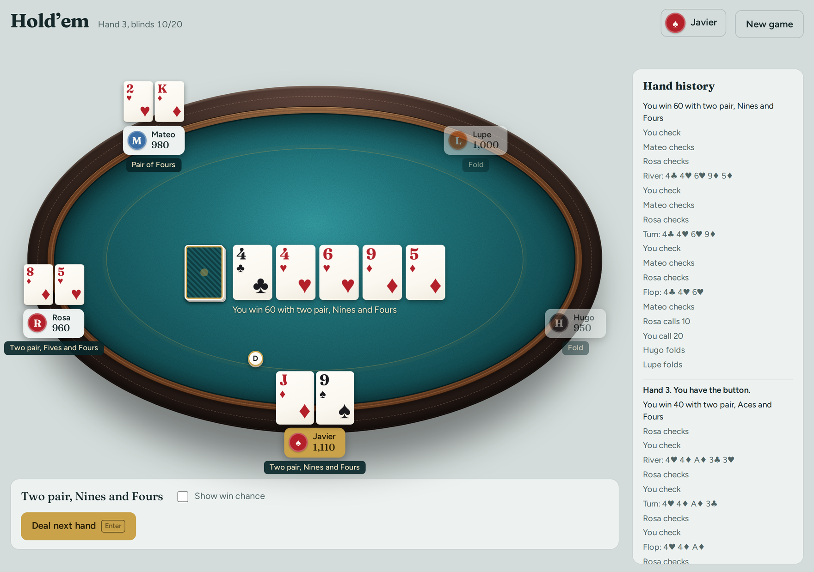

  <picture>
    <source media="(prefers-color-scheme: dark)" srcset="docs/screenshot-dark.png">
    
  </picture>

<h1 align="center">Hold’em</h1>

No-limit Texas Hold’em against computer opponents. Free, offline, no ads.

<a href="../../releases/latest"><b>Download the latest version</b></a>

 

**Five opponents, five styles.** Cautious Hugo, reckless Lupe, and three more who play the way they talk.

**A real table.** Cards dealt from the deck, chips that stack and slide, side pots done right.

**Your seat, your record.** Pick a name and a look, and every game you play is tracked.

## Install

**Windows:** download the `.exe` and double-click it. If Windows warns you, choose More info, then Run anyway.

**Ubuntu and Debian:** `sudo apt install ./holdem_*_amd64.deb`

**Other Linux:** extract the `.tar.gz` and run `./install.sh`

Building it yourself or running your own sync server? See <a href="docs/DEVELOPMENT.md">docs/DEVELOPMENT.md</a>.
